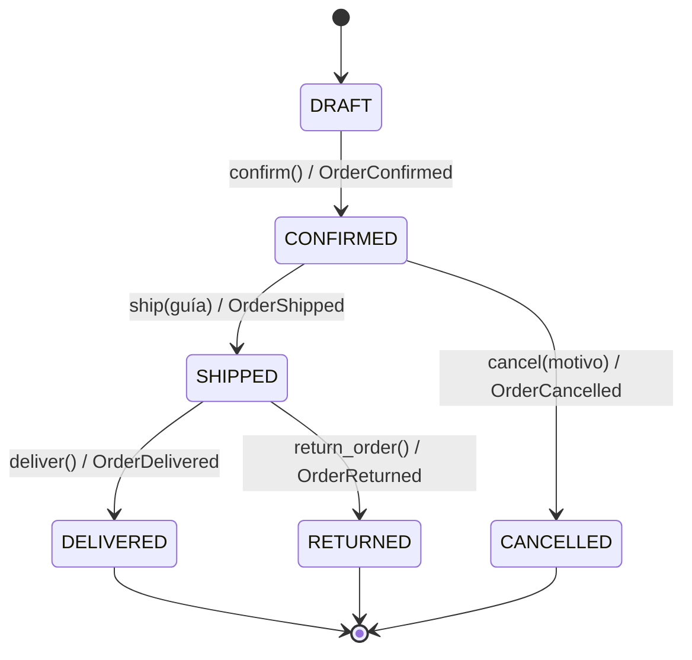

# TechStore U4 · Lógica de negocio con FastAPI

Administra pedidos en memoria: carga clientes, productos y pedidos desde CSV, aplica reglas de descuento con Specifications, controla el estado de cada pedido con Domain Events y expone una API REST. Al cerrar el programa los cambios se pierden.

## Instalación

```bash
python -m venv .venv
# Windows PowerShell: .venv\Scripts\Activate.ps1
# macOS / Linux:      source .venv/bin/activate
python -m pip install fastapi uvicorn pytest httpx
```

## Ejecución

```bash
python cargar_csv.py            # carga y lista los 16 pedidos (todos DRAFT)
python ejecutar_escenarios.py   # corre E01-E15 y genera evidencias/bitacora_escenarios.md
python -m pytest -q             # pruebas automáticas
uvicorn app.api:app --reload    # API; documentación en http://127.0.0.1:8000/docs
```

## Estructura

```
datos/                   CSV del paquete (clientes, productos, pedidos, detalle, escenarios)
cargar_csv.py            cargador del paquete
app/domain.py            Money, Customer, OrderItem, Order, estados y eventos
app/specifications.py    Specification (AND, OR, NOT) y reglas de descuento
app/api.py               API REST (solo coordina; las reglas viven en Order)
tests/                   test_domain.py, test_api.py
evidencias/              bitácora de escenarios
```

## Reglas de negocio

- `Money` es inmutable, usa `Decimal`, rechaza montos negativos o no finitos y solo suma la misma moneda (MXN).
- Máximo **20 unidades** por pedido (se suman unidades, no renglones). Solo un pedido en `DRAFT` admite artículos.
- **Descuento 10 %:** cliente VIP, total **> 500**, **>= 4** unidades y sin promoción activa.
- **Descuento 5 %:** total **> 5000** y sin promoción activa.
- Si se cumplen ambas, se aplica el 10 %.
- Confirmar exige artículos y cliente activo. Enviar exige guía no vacía. Cancelar exige motivo no vacío.
- Una operación inválida no cambia el estado ni agrega eventos.

## Máquina de estados



## Domain Events

| Evento | Se registra cuando |
|---|---|
| OrderConfirmed | `confirm()` pasa de DRAFT a CONFIRMED |
| OrderShipped | `ship()` pasa de CONFIRMED a SHIPPED con guía válida |
| OrderCancelled | `cancel()` pasa de CONFIRMED a CANCELLED con motivo |
| OrderDelivered | `deliver()` pasa de SHIPPED a DELIVERED |
| OrderReturned | `return_order()` pasa de SHIPPED a RETURNED |

Los eventos se registran **después** de validar y cambiar el estado, así que un intento fallido nunca deja un evento.

## Endpoints

| Método | Ruta | Respuestas |
|---|---|---|
| GET | `/orders` | 200 lista de pedidos |
| GET | `/orders/{id}` | 200 detalle con descuento y eventos; 404 |
| POST | `/orders/{id}/confirm` | 200; 404; 409 transición inválida; 422 sin artículos o cliente inactivo |
| POST | `/orders/{id}/ship` (`{"tracking_number": "..."}`) | 200; 404; 409; 422 sin guía |
| POST | `/orders/{id}/cancel` (`{"reason": "..."}`) | 200; 404; 409 desde SHIPPED; 422 sin motivo |
| POST | `/orders/{id}/deliver` | 200; 404; 409 |
| POST | `/orders/{id}/return` | 200; 404; 409 |

Códigos: **404** pedido inexistente, **409** transición no permitida, **422** datos inválidos.
